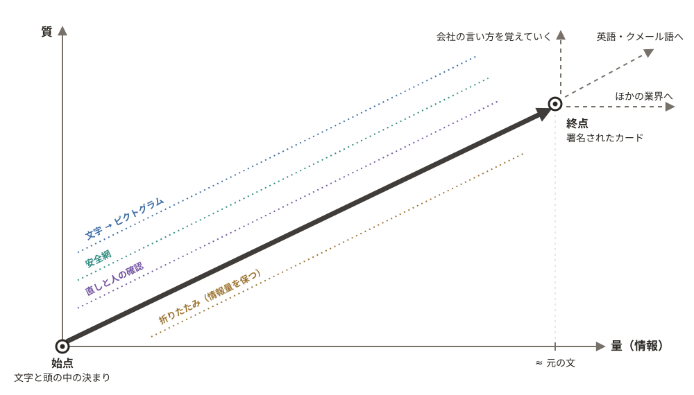

# genba-kamishibai

[](https://github.com/tirotiro0207/genba-kamishibai/actions/workflows/test.yml)

[English](README.md) | 日本語

> **下書きです。** この README は書いている途中です。**TBD** と書いた数は、最後に数えるスクリプトの出力で埋めます。**not built** と書いたものは、まだありません。進み具合: [docs/progress.md](docs/progress.md) ・ 作業の表: [docs/plan.md](docs/plan.md)

## Try it（触り方）

- 公開のデモ: **https://genba-kamishibai.ikjshare.workers.dev** — 架空の会社で開きます。ログインも PIN も要りません
  - 署名済みのカードを 1 枚ずつ見る、絵から元の文へ戻る経路を開く、自分で書いた短い決まりからカードを作る（デモには 1 日の上限があります）
  - 新入社員と同じやり方で自分も試す:「時間を計って答える」と「絵だけで答える」
- 会社のテナントは非公開です。テナントの PIN → 役割（作者・監修者・教育担当・新入社員）の PIN の 2 段で入ります
  - 会社の中は、入口を 2 つに分けています: **作る側**（作者・監修者・教育担当。タブはカードの管理・キャラクターの管理・アセットの 3 つ）と、**見る側**（新入社員と現場の人。署名済みのカードだけ）。テストがあるときは、見る側の下から入ります
  - 新しいカードはチャットで作ります: PDF・Word・Excel・文字のファイル・貼り紙の写真を添付し、作りたいものを言葉で書きます。返事は決まりの箇条書きで、最初から全部にチェックが付いています。作らないものを外して「これらのカードを作成する」を押します
  - アセット: 絵に使う小物を全部並べます。直したいことを書き、写真や手描きを添付すると、Claude が部品を描き直し、前と後を並べて見せます。会社の部品にできるのは作者か監修者だけで、版はすべて残します
  - 現場の試しの答えの採点: `#/t/<テナント>/score`。左が作者、右が監修者のタブです。答えごとに 1〜10 の点とコメントを付け、もう 1 人の点は見えません（追記だけ）
- 最初の画面の「ゲストで動作確認する」は、その人だけの使い捨ての置き場を作り、作者の役で作る側を開きます（見る側は出しません）。キャラクターを作るときの業種は、今は電気工事だけ選べ、ほかは並べたまま鍵がかかっています。ゲストが AI を呼べる回数には 1 日の上限があります



文字と頭の中にあった現場の決まりを（始点）、情報を失わずに絵へ折りたたみ（質・量）、署名されたカードとして新入社員に届ける（終点）。そこから業界を広げ、国籍が増えても訳ではなく絵とやさしい日本語（ふりがなつき）で届け、会社の言い方を覚えていく（終点の先）。

縦が質、横が量（情報）。マスごとの進み具合は [docs/dashboard.html](docs/dashboard.html)・[docs/plan.md](docs/plan.md)、手描きは [docs/sketches/shinro.jpg](docs/sketches/shinro.jpg)

## The Problem（困っていること）

- 現場の安全の決まりは、文字の資料と、ベテランの頭の中にある
- 外国籍の新入社員には、日本語の文字ではそれが届かないことが多い
- 教える側にも、伝わる教材を作る時間がない
- 事故は、慣れて自信がついたところから過信に変わる際で起きる。ベテランも決まりを頭の中に持つ側だけでなく、読む側にいる。作業の場所に貼ったカードは、画面と並ぶもう 1 つの守りになる

## Why I built this（作った理由）

- 作者は、外国籍の新入社員を迎える電気工事会社（1923 年創業）と一緒に仕事をしている（2026-11-06 の現場の試しでは、ベトナム・ミャンマー・カンボジアの人と、日本の新入社員 2 人）
- 現場で決まりを読み違えると、人がけがをする。誰も確かめていない機械の訳より、監修者が確かめて署名した絵のカードのほうが安全
- カードの言葉はやさしい日本語だけです。監修者が読んで納得したものだけに署名するため、監修者が読めない訳は載せません
- 向かう先: [docs/compass.md](docs/compass.md)

## Ideas behind it（考え方）

迷ったら戻る軸（[docs/compass.md](docs/compass.md)）から:

- **変化の質: 自然な言葉が、絵になる。** 話した言葉や資料の文が、ピクトグラムのカードに変わる。質とは「伝わるか」の 1 つで、絵にすること、危ない読み違いを止める安全網、監修者と新入社員の声で直すこと、の 3 つで上がる
- **変化の量: 削らずに、折りたたむ。** 見る人が一度に目にする量は減るが、カードが持つ情報は元の文と同じ（カード ≈ 元の文）。絵は情報を折りたたんだもので、開けば部品ごとに元の行へ戻る**経路**がある。だから、どのカードも元の文に必ず戻れる
- **訳さない。** カードの言葉は、国のやさしい日本語のガイドライン（3 つのステップ。[docs/yasashii-nihongo.md](docs/yasashii-nihongo.md)）に合わせた、ふりがなつきのやさしい日本語だけ。監修者は読めるものにだけ署名し、国籍が増えても同じカードが使える
- **署名するのは人、守らせるのはサーバー。** Claude は下書きと確かめをする。読む人に届くのは監修者が署名したカードだけで、署名の無い・止めた・署名のあとに変わったカードはサーバーが渡さない
- **ベテランも読む。** 事故は、自信が過信に変わる際で起きる。同じカードを朝礼で読み、作業の場所に貼って、画面と並ぶもう 1 つの守りにする
- **紙芝居。** カードは 1 枚ずつ見せ、画面も紙芝居の絵を抜くように動く

## What it does（できること）

日本語で書かれた決まり（またはベテランが話した言葉）を、絵のカードにする。ピクトグラムで「何をするか」と「なぜか」を見せ、日本語の文字を読まなくても分かるようにする。新入社員に届くのは、監修者が直して署名したカードだけ。

流れ（詳しくは [docs/flow.md](docs/flow.md)）:

1. **入れる** — 決まりを貼るか話す。またはマニュアルの PDF を添付する（ページは画像と行番号付きの文字になる）
2. **取り出す** — Claude が決まり（やること・やらないこと・なぜ）を、元の文の行に結び付けて取り出す。どれをカードにするかは人が承認する
3. **カードを作る** — Claude がカードの文と、ピクトグラムの人形のキーフレームを数字で書き、アプリが絵を描く。絵のどの部品にも、元の文に戻る**経路**が残る
4. **確かめる** — 別の Claude の呼び出しがコマだけを見て意味を当て、カードを赤・黄・緑で採点する。赤のカードは確認待ちの列の先頭に来る
5. **人が直す** — 監修者が違う部品に枠を描き、何を変えるかを言う。作り直すのはそのカードだけ。関節と小物は手で動かすこともできる
6. **署名** — 監修者が指か電子印鑑で署名する。監修者ごとに 1 日の上限があり、署名の無いカードはサーバーが渡さない
7. **配る** — 署名済みのカードが、紙芝居のように 1 枚ずつ新入社員に届く。カードを止められるのは監修者だけで、理由は必ず書く。止めると教育担当に回収の知らせが出る（見た人の一覧と、はがす貼り紙は発行の管理に出る）

画面（架空の会社。仮の写真で、絵が決まったら撮り直します）:

| | |
|---|---|
|  公開デモの入口 |  カード: 絵と、「未承認の下書き」の帯と確かめの帯 |
|  経路: 絵の部品 → 元の文の行 |  確認待ち: 赤のカードが先頭 |
|  電子印鑑で署名 |  新入社員に届く画面: 署名済みのカードを 1 枚ずつ |

ほかに作ったもの:

- 役割: 作者・監修者 2 名・教育担当・新入社員。会社のテナントは、テナントの PIN と役割の PIN が要る
- 監査の記録: カードごとの記録（元の文 → 作成 → 確かめ → 人の直し → 署名）を、追記だけ・ハッシュの連鎖で残す。監修者と教育担当が見る画面つき
- 折りたたみの画面: 元のページが積み重なり、文字の無い 1 枚のカードにたたまれるのを見せる
- 現場の確認のための回答の記録アプリ: 時間を計る（カードと文）、自由な答え、採点 2 人、名前を消した CSV の書き出し、やめた参加者の消去、答えが入る前に書く教育担当のカードごとの見込み
- 採点の画面（11/7）: 作者と監修者が、答えごとに 1〜10 の点とコメントを付け、カードごとにも「絵だけでどれだけ伝わるか」を付ける。もう 1 人の点は見えず、記録は追記だけ。母語で書かれた答えには、採点する人が読めるように Claude の参考の日本語の訳を付けられる（参加者がやめたときは答えと一緒に消す）
- マニュアル全部の夜間の仕分け（作業員が守る決まりがあるページはどれか）と、監修者が答えを入れ替える画面
- 読み手パネル: 24 人の仮の読み手（出身 × 日本語の文字を読む力 × 経歴）。1 人が Claude Code のサブエージェント 1 つで、本番の確認の前に伝わらない絵を見つけるのに使う。結果: [docs/readers.md](docs/readers.md)
- MCP サーバー: ほかの道具からカードを頼める。作れるのは**未承認の下書き**だけ
- PNG・SVG の書き出し。どの絵にも版・署名の日・コマの番号が入る
- 画面の行き来: ホームから確認待ち・発行の管理・試しの回・資料から作る・カードごとの画面（経路・折りたたみ・記録・署名）へ行ける。ほかの画面の上には「← ホーム」の帯がある
- 新しい型（11/7 の既定。作者の確認待ち。詳しくは [docs/decisions.md](docs/decisions.md)）:
  - **原則のカード**（`shape=principle`）だけ、3〜4 コマの例外として 1 コマを許す。作る画面で「原則の 1 コマで作る」を選んだときだけ。ほかのカードは 3〜4 コマのまま
  - **束**: 1 つの取り出しの同じ親の決まりから作った枚は、束（名前・何枚目・全部で何枚・親の決まり）として順に並ぶ。1 つの束は 30 枚まで
  - **重さ**: 監修者がカードを「命に関わる」か「ふつう」にする。命に関わるカードは、絵の外側（読む画面と、書き出し・印刷の外枠）に赤い縁が付く。絵の中には置かない
  - **掲示の版**: 1 枚のカードのコマを大きく 1 枚にまとめた横長の貼り紙（ふりがな・版・日付つき）と、原則のカードを 1 列に並べた版
  - **朝礼の組**: その日の作業を書くと、合いそうな署名済みのカードを最大 8 枚出す（命に関わるカードを先に）。選んだ組を残す
  - **貼った場所**: 署名済みのカードを貼った場所を記録できる。止めたカードの貼り紙は、回収の知らせに「はがす紙」として出る
  - **過去の事故**を「なぜ」の出どころとして足せる

### 中の動き: どの段がどこで動くか

アプリは Cloudflare の Worker 1 つ（Hono）と、D1（記録）・R2（ファイル）、Vite で組む React の画面です。絵は画像の生成モデルではなく、アプリ自前の SVG のコードが描きます。Claude が書くのは数字（関節の角度・小物・位置）だけです。

| 段 | コードの場所 |
|---|---|
| 入れる（チャットに添付: PDF・Word・文字・紙の写真） | `src/client/chat/`、`src/worker/chat.ts`（PDF のページ → Claude で文字に）、`src/client/make/` |
| 取り出す（元の行つきの決まり） | `src/shared/extract/`、`src/worker/extract.ts` |
| カードを作る（文・キーフレーム・経路。ふりがなつきのやさしい日本語の言葉） | `src/shared/make/maker.ts`・`words.ts`、`src/shared/ruby.ts`。2 段の脚本の段（`script.ts`）は 11/6 から既定で使わない |
| 描く | `src/shared/picto/`（骨組み → 名前のある姿勢 → 服と髪のキャラクター → 小物 → 場面）。新しい姿勢は名前のある姿勢から作り、7 つ以上の関節は固定、動かすのは 3 つまで・30° まで |
| 確かめる・安全網 | `src/shared/verify/`（コマだけを読む。線を越え、危ない読み違いが無いときだけ通る）、確認待ちの列 `src/worker/queue.ts` |
| 人が直す | `src/client/fix/`、`src/client/pose/`、`src/shared/rework.ts`（枠の中の部品だけを作り直すので、経路は保たれる） |
| 署名 | `src/worker/sign.ts`、`src/client/sign/` |
| 届ける | `src/worker/read.ts`（署名済みで変わっていないものだけ。経路は返さない）、`src/client/read/`、`src/worker/issue.ts`（止める・回収・見た人） |
| 監査 | `src/shared/audit.ts`、`src/worker/audit.ts`（追記だけ・ハッシュの連鎖） |
| 夜間の仕分けと下書き | `src/node/night*.ts`、`src/node/managed-sort.ts` |
| ほかの道具から | `src/worker/mcp.ts`（MCP。作れるのは下書きだけ） |
| 現場の試しと採点 | `src/worker/trials.ts`、`src/worker/scores.ts`、`src/client/trial/`、`src/client/score/` |
| ゲストの置き場 | `src/worker/guest.ts`（ゲストごとに使い捨ての置き場・1 日の上限） |
| アセット | `src/worker/assets.ts`、`src/client/assets/`、`src/shared/picto/prop-override.ts`（版は追記だけ。Claude が返した SVG は安全な要素だけに絞る） |
| 共有された更新の取り込み | `scripts/intake-check.ts`、`scripts/git-hooks/post-merge`、`.github/workflows/intake.yml`、[docs/sharing.md](docs/sharing.md) |

### 現場の試し（2026-11-06）

- 4 か国の新入社員 14 人（日本 2・ミャンマー 2・ベトナム 2・カンボジア 8）が、ノートパソコンで 2 つの試しを受けた: ① 2 項目の分かるまでの時間（片方はカード、もう片方は元のマニュアルのページ）、② 8 枚のカード（1 人の半分のカードはやさしい日本語の文つき、半分は絵だけ。2 つは分けて数え、参考の線は絵だけに当てる）
- 数え方は答えを見る前に固め、ハッシュを [docs/numbers.md](docs/numbers.md) に残した: [docs/fieldday-2026-11-06.md](docs/fieldday-2026-11-06.md)
- アプリに答えが届いたのは 9 人（日本 2・ミャンマー 2・ベトナム 2・カンボジア 3）で、① は 28 件中 18 件、② は 112 件中 48 件。届かなかった答えとそのわけは [docs/failures.md](docs/failures.md) の 4 節。届かなかった分を推し量って数に入れることはしない
- 採点は途中: 作者と監修者が、それぞれ別々に、答えごとに 1〜10 の点とコメントを付ける。数の表に入れるのは、2 人とも付け終わってから
- 午後は、監修者 2 人がそれぞれカードを承認し、印刷したカードを朝礼の形で使った。ベテランの電気工事士が現場を模して貼って使い、「絵があって分かりやすい」「やさしい日本語に必要なことが全部あり、抜け漏れが無い」「朝礼で使いたい」と話した。直したい点は 2 つ: 印刷のコマをもっと大きく、分電盤などの器具の小物を現場の物に寄せる（会期のあと）

データの持ち主: 直しと署名の記録は、登録した会社の物です。作者の会社は預かるだけで、ほかの会社のカードの下書きには使いません。絵の直し方（「この姿勢は逆に読まれた」）だけは、会社の文とすべての名前を外し、会社が「使ってよい」を選んだときだけ共通の描き方に戻します。最初は「使わない」で、今はどの会社も「使わない」です（切り替える設定はまだありません）。自分で動かすときは、データは全部手元に残ります。詳しくは [docs/consent.md](docs/consent.md)

## How Claude is used（Claude の使い方）

| どこで | モデル | すること |
|---|---|---|
| PDF → 文字 | Claude Opus 5.5 | 文字の層が無いページだけ画像を読み、行の位置つきで文字にする |
| 取り出し | Claude Opus 5.5 | 決まり（やること・やらないこと・なぜ）を元の位置つきで取り出す |
| カードの作成 | Claude Opus 5.5 | キーフレームと、絵の部品ごとの経路を数字で書く（絵は直接描かせない） |
| 確かめ | Claude Opus 5.5 | コマだけを見てカードを採点する。カードの文は見せない |
| 言葉の欄 | Claude Opus 5.5 | カードの文だけから、やさしい日本語の短い文を書く（ベトナム語の文は任意。書けたときだけ内部に残し、届けない） |
| 夜間の仕分け | Claude Managed Agents | マニュアル全部を 1 ページずつ読み、作業員が守る決まりがあるページを言う。途中から続けられる |
| 取り出しの採点 | Claude Sonnet 5.5 | 取り出した決まりを評価データの答えと比べる |
| 読み手パネル | Claude Code のサブエージェント（既定は Sonnet 5.5） | 読み手 1 人 = サブエージェント 1 つ。答えにモデルの ID を残す |

- API の呼び出しは全部、費用つきで記録する。用途ごとに費用の上限がある（1 回・1 日・全体）
- このアプリそのものは Claude Code で作った

### API で流す前に、同じプログラムを通しで流した

夜間の一括を API で流す前に、Claude を呼ぶところだけを `claude -p`（サブスクリプションの Claude Code の CLI）に差し替えて、同じプログラムを最初から最後まで流した。データベースへの書き込み・再開の仕組み・検査は、そのままにした。こうすると、プロンプトの出来だけでなく、プログラムそのものの不具合（答えを読み取れない・再開でずれる・ページが抜ける）も見つかる。会話の中の Claude に作業を代わりにやらせると、プログラムを通らないので、こうした不具合は見つからない。

- 流したもの: 109 ページの仕分け、62 ページから下書き 123 枚、4 本同時、わざと止めて再開。再開のずれは 0
- 見つかった問題: 8 件。API の前に 3 件を直した（手元のデータベースへの同時の書き込み、ベトナム語の小数点の「,」を新しい数字と読んだこと、再開のずれを数える道具が無かったこと）。残りの 5 件は、残す理由と一緒に書いてある
- 詳しくは [docs/dry-run-063.md](docs/dry-run-063.md)

### 監修者の確認から分かった AI の弱点

決まりの取り出しを、法令と公開の資料から切り出した 30 項目（開始前と会期中の節の評価データ）で試し、監修者 2 名が全部の答えに印を付けた。分かった AI の弱点:

- 補足や例外は、文のすぐ近くにあるとは限らない（同じ項の後半・別の条・施行規則・通達）。AI は目の前の文だけでまとめるので、見落とす。「ただし」「除く」などの手がかりの言葉で拾えるのは一部だけ
- 「なぜ」は元の文に書いていないことが多い。AI は書かずに残し、監修者が「誰の何を守るためか」を書き足した
- やさしく言い換えると、意味が変わることがある（例:「6 か月続けて働き」が「1 日も休まずに働く」と読まれる）
- 調整用の 20 項目では点が 0.81 から 0.96 に上がったが、取っておいた 10 項目は 0.79 から 0.80 だった。伸びは移らなかった
- 試す資料から例を取ると、点が良く見えても力とは言えない。指示の例は資料の外から取り、どのプロンプトにも資料との重なりの検査をかける

このため、監修者の確認は仕組みが頼っている段で、おまけではない。詳しくは [docs/lessons-extraction.md](docs/lessons-extraction.md)

## Quick Start（動かし方）

Node.js 24 が要ります。

```bash
npm ci
```

```bash
npm test
```

【手元限定】の付いたテストは、`private/` の中のファイルやマニュアルの PDF が要り、無いときは飛びます（CI ではいつも飛びます）。

手元でアプリを動かすときは、`.dev.vars` に `SESSION_SECRET`（長い乱数の文字列）と `ANTHROPIC_API_KEY` を書きます。`SESSION_SECRET` は必ず要ります。無いと役割で入れません。API の鍵が無くてもアプリは起動して画面は全部開きますが、Claude の呼び出し（取り出し・カードの作成・確かめ）は 503 になります。`SESSION_SECRET` だけで始めるとき:

```bash
node -e "require('fs').writeFileSync('.dev.vars', 'SESSION_SECRET=' + require('crypto').randomBytes(32).toString('hex') + '
')"
```

ファイルは Node が自分で書くので、bash でも Windows PowerShell でも同じに動きます（`> .dev.vars` で書くと、Windows PowerShell 5 は UTF-16 で書き、wrangler が読めずに `SESSION_SECRET` が無いことになります）。`.dev.vars` は上書きされます。

役割ごとに出す名前（`SUPERVISOR_1_NAME`・`SUPERVISOR_2_NAME`・`TRAINER_NAME`・`AUTHOR_NAME`）も `.dev.vars` に書きます。無ければ空欄になります。`scripts/` の Node のスクリプトは、代わりに `.env` を読みます（`.env.example` を参照）。

```bash
npx wrangler d1 migrations apply DB --local
```

架空の会社の署名済みのカード 10 枚は、種データ（`demo/seed.sql`。架空の会社の分だけ）として入っています。マイグレーションのあとに 1 回入れると、架空の会社の画面（`/` と「自分も試す」）とその録画（`demo`・`try`）が、API の鍵なしで動きます:

```bash
npx wrangler d1 execute DB --local --file demo/seed.sql
```

デモのカードを一から作り直すときは、流れを全部通すので Claude を呼びます。`ANTHROPIC_API_KEY` が要ります（`npm run dev` を動かしたまま）: `BASE_URL=http://localhost:8787 npx tsx scripts/demo-cards.ts` のあとに `npx tsx scripts/demo-seed.ts` で種データを書き直します。

```bash
npm run dev
```

開いたら http://localhost:8787/#/t/practice/make を開きます（練習用テナント。PIN は要りません）。8787 番が使われているときは `npm run dev -- --port 8799` にします。

録画のテスト（1 本ずつ流します。手元のデータベースは同時の書き込みを受けません）。最初の 1 回だけ、ブラウザを入れます:

```bash
npx playwright install chromium
```


```bash
npx playwright test --workers=1
```

### ほかの道具から使う（MCP）

Worker は `/mcp/<テナント>` で MCP サーバー（Streamable HTTP）にもなります。「この資料をカードにして」と頼むと、同じ流れが走ります: 取り出し → 選んだ決まりの承認 → カードの作成。署名・承認・停止の道具は無く、しようとする呼び出しは断ります。署名は監修者が画面でします。

- 会社のテナントごとに鍵が要り、`Authorization: Bearer <鍵>` で送ります。鍵なしで使えるのは架空の会社だけです（手元の環境では）。公開の置き場では、練習用と架空の会社も鍵が要り、見るだけです（使えるのは `list_documents` と `get_card` だけ。取り出しと作成は断り、`initialize` でもそう告げます）。下の `/mcp/demo` の例は手元の環境の話です
- 手元のテナントの鍵を作る（鍵は `private/tenants/<テナント>-mcp.json` にだけ書き、データベースにはハッシュを残します）:

```bash
npx tsx scripts/add-mcp-key.ts practice
```

```bash
claude mcp add --transport http genba http://localhost:8787/mcp/demo
```

- 道具: `list_documents`・`doc_to_cards`・`extract_rules`・`make_drafts`・`get_card`

## Before / During（開始前と会期中）

作る期間（2026-11-02 から）の前にあったものと、期間中に作ったもの。

**開始前**

- 評価データ（`eval/`）: 作者が労働安全衛生の法令と厚生労働省の公開資料から選んだ 30 の元の文。出典は各行にあります。答えは作者が AI の助けを借りて下書きし、現場の監修者 2 名が確かめているところです。20 個を調整に使い、10 個は最後の確認のために分けてあります（リポジトリにあるのはハッシュだけ）。30 個の答えは、どのプロンプトにも例にも入れていません
- 手で描いたスケッチ（`docs/sketches/`）: 作者が描いたもの。ピクトグラムの部品はこれに合わせて直しました
- 試した会社の安全のマニュアル: 会社の資料なので、このリポジトリには入れていません。そこから作ったカードは、その会社の非公開のテナントにだけあります

**会期中**

- コードは全部、一から書きました。期間の前に作ったコードや HTML は持ち込んでいません
- 本番のプロンプトは全部、一から書きました
- カードの言葉の欄のベトナム語は Claude が訳し、小さな用語表（日本語・ベトナム語・どのカードで使うか）にまとめました。ベトナム語の文は任意で、書けたときだけ内部に残し、届けません（カードはやさしい日本語だけ）

## Disclosure（利害の開示）

作者は、これを試した会社（電気工事会社、1923 年創業）に、別の有償の翻訳のサービスを出しています。結果が作者に都合よく傾かないように、新入社員の答えはアプリ自身が記録し（追記だけで、直しも消しもできない）、公開に同意した人の答えは名前を消して `docs/answers.csv` に出します。

この製品には、翻訳の機能を意図して入れていません。監修者が読んで確かめられない文は、届けないためです。（言葉の欄のベトナム語の文は任意で、書けたときも内部に残すだけで、届けません）

作者は将来、これをホストしたサービスとして提供するつもりがあります（MCP は会社ごとの鍵）。

## Who it is for（誰のためか）

TBD — 1 段落: 誰が払うか（外国籍の働き手を迎える会社。まず電気工事から）、何に払うか（自分たちのマニュアルを、監査の記録つきで署名済みの絵のカードにすること）、何が無料のまま残るか。

## Numbers（数）

| | |
|---|---|
| 最初のコミット | 2026-11-02 13:21（日本時間） |
| コミット数 | TBD |
| テスト数 | TBD |
| 新入社員に伝わった絵（絵だけ） | TBD |
| 危ない読み違い | TBD |
| 分かるまでの時間: カードと文 | TBD |

測った数と出どころ: [docs/numbers.md](docs/numbers.md)

## Not built（まだ無いもの）

- 新入社員との現場の確認の結果 — **not built**（採点 2 人の採点が途中）
- アセット: 描き直せるのは今は小物だけ（姿勢・髪・服はまだ）。描き直した部品が使われるのはブラウザで描く絵だけで、書き出しと動画の静止画はまだ元の絵 — **not built**
- 取り込みの見張りのうち、お金のかかる評価（調整用の 20 個の流し直し）は `--run-paid` を付けたときだけ流す。CI では API を呼ばず「評価が要る」で止める — 足りないのではなく、そう決めた形
- 2 分と 3 分の動画 — **not built**
- 会社の言葉の一覧・直す・消す画面（保存と、次のカードの手本への混ぜ込みまではある）— **not built**
- 電気工事と労働条件の Skills（`skills/`）: 下書きだけで、どの呼び出しにもまだつないでいない — **not built**

## Appendix（付録）

- 仕組みを段ごとに: [docs/flow.md](docs/flow.md)
- 決めたことと理由: [docs/decisions.md](docs/decisions.md)
- 読み手パネル: [docs/readers.md](docs/readers.md)
- 測った数: [docs/numbers.md](docs/numbers.md)
- 制作の記録: [docs/build-log.md](docs/build-log.md)
- 画面の点検の一覧: [docs/audit.md](docs/audit.md)
- API のメモ（画面から呼ばない口と、11/7 に足した口）: [docs/api.md](docs/api.md)
- 動かし方の細かいこと（本番の手順・夜間の一括・CI・本番へ写す道具）: [docs/operations.md](docs/operations.md)
- 黄色の行の測り方: [docs/numbers.md](docs/numbers.md)

## License（ライセンス）

- コード: **GNU Affero General Public License v3.0（AGPL-3.0）**。全文は [LICENSE](LICENSE)
- `docs/` の文書と、ピクトグラムの部品の一覧から書き出した絵（PNG・SVG）: **クリエイティブ・コモンズ 表示 4.0（CC BY 4.0）** — https://creativecommons.org/licenses/by/4.0/deed.ja
- 「現場の紙芝居」（genba-kamishibai）の名前とロゴは、どちらのライセンスにも含みません

選んだ理由: 現場の安全に関わる道具なので、誰かが改良してサービスにしたら、その改良も公開されて全員に戻ってくる形にしました。部品と文書は、ほかの業界の人が自由に使い回せるように CC BY にしました。
