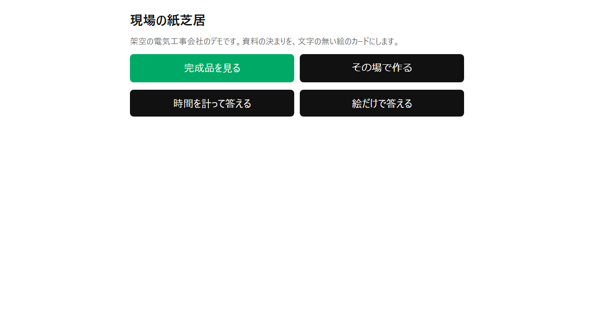
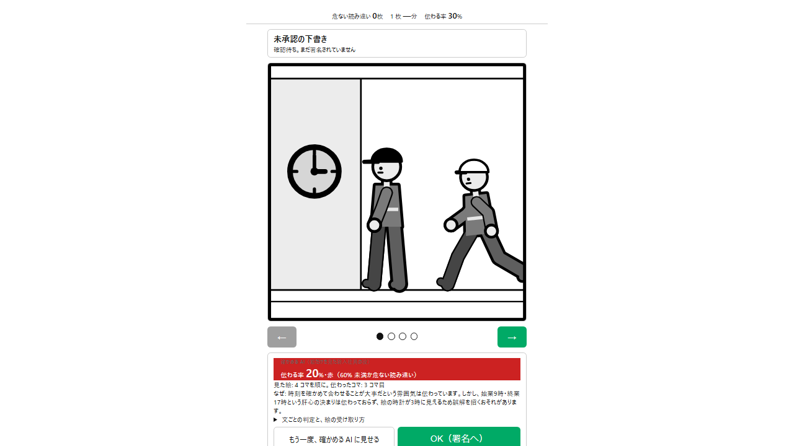
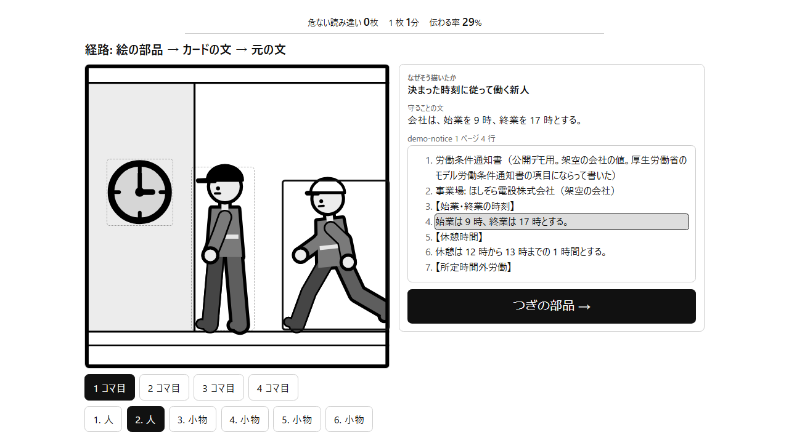
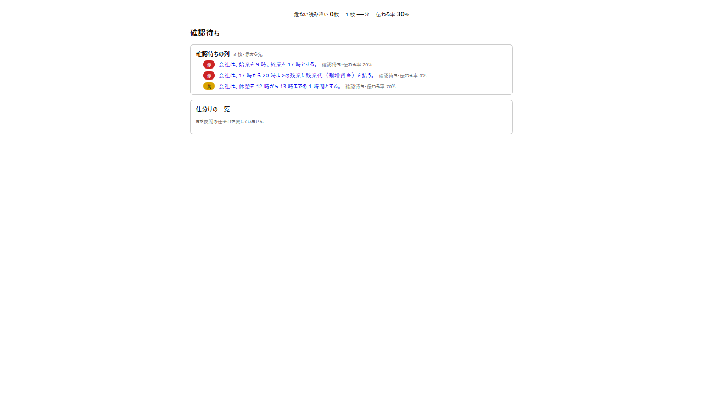
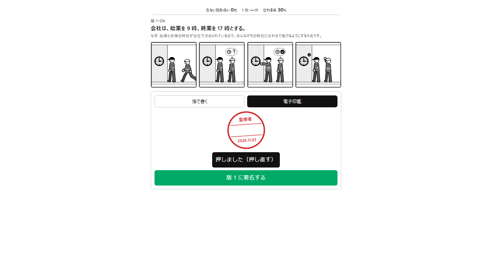
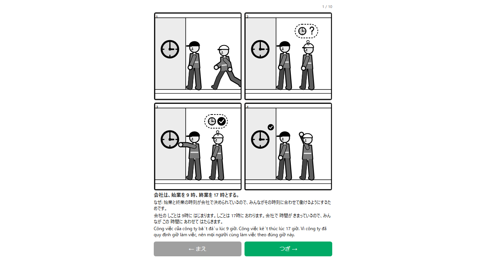

# genba-kamishibai

[](https://github.com/tirotiro0207/genba-kamishibai/actions/workflows/test.yml)

[English](README.md) | 日本語

> **下書きです。** この README は書いている途中です。**TBD** と書いた数は、最後に数えるスクリプトの出力で埋めます。**not built** と書いたものは、まだありません。進み具合: [docs/progress.md](docs/progress.md) ・ 作業の表: [docs/plan.md](docs/plan.md)

## Try it（触り方）

- 公開のデモ: **https://genba-kamishibai.ikjshare.workers.dev** — 架空の会社で開きます。ログインも PIN も要りません
  - 署名済みのカードを 1 枚ずつ見る、絵から元の文へ戻る経路を開く、自分で書いた短い決まりからカードを作る（デモには 1 日の上限があります）
  - 新入社員と同じやり方で自分も試す:「時間を計って答える」と「絵だけで答える」（**まだ出していません** — 次に本番へ出すときに入ります）
- 会社のテナントは非公開です。テナントの PIN → 役割（作者・監修者・教育担当・新入社員）の PIN の 2 段で入ります

## The Problem（困っていること）

- 現場の安全の決まりは、文字の資料と、ベテランの頭の中にある
- 外国籍の新入社員には、日本語の文字ではそれが届かないことが多い
- 教える側にも、伝わる教材を作る時間がない

## Why I built this（作った理由）

- 作者は、ベトナムから新入社員を迎える電気工事会社（1923 年創業）と一緒に仕事をしている
- 現場で決まりを読み違えると、人がけがをする。誰も確かめていない機械の訳より、監修者が確かめて署名した絵のカードのほうが安全
- 向かう先: [docs/compass.md](docs/compass.md)

## What it does（できること）

日本語で書かれた決まり（またはベテランが話した言葉）を、絵のカードにする。ピクトグラムで「何をするか」と「なぜか」を見せ、日本語の文字を読まなくても分かるようにする。新入社員に届くのは、監修者が直して署名したカードだけ。

流れ（詳しくは [docs/flow.md](docs/flow.md)）:

1. **入れる** — 決まりを貼るか話す。またはマニュアルの PDF を添付する（ページは画像と行番号付きの文字になる）
2. **取り出す** — Claude が決まり（やること・やらないこと・なぜ）を、元の文の行に結び付けて取り出す。どれをカードにするかは人が承認する
3. **カードを作る** — Claude がカードの文と、ピクトグラムの人形のキーフレームを数字で書き、アプリが絵を描く。絵のどの部品にも、元の文に戻る**経路**が残る
4. **確かめる** — 別の Claude の呼び出しがコマだけを見て意味を当て、カードを赤・黄・緑で採点する。赤のカードは確認待ちの列の先頭に来る
5. **人が直す** — 監修者が違う部品に枠を描き、何を変えるかを言う。作り直すのはそのカードだけ。関節と小物は手で動かすこともできる
6. **署名** — 監修者が指か電子印鑑で署名する。監修者ごとに 1 日の上限があり、署名の無いカードはサーバーが渡さない
7. **配る** — 署名済みのカードが、紙芝居のように 1 枚ずつ新入社員に届く。カードは理由を書いて止められ、見た新入社員には回収の知らせが出る

画面（架空の会社。仮の写真で、絵が決まったら撮り直します）:

| | |
|---|---|
|  公開デモの入口 |  カード: 絵と、「未承認の下書き」の帯と確かめの帯 |
|  経路: 絵の部品 → 元の文の行 |  確認待ち: 赤のカードが先頭 |
|  電子印鑑で署名 |  新入社員に届く画面: 署名済みのカードを 1 枚ずつ |

ほかに作ったもの:

- 役割: 作者・監修者 2 名・教育担当・新入社員。会社のテナントは、テナントの PIN と役割の PIN が要る
- 監査の記録: カードごとの記録（元の文 → 作成 → 確かめ → 人の直し → 署名）を、追記だけ・ハッシュの連鎖で残す。監修者と教育担当が見る画面つき
- 折りたたみの画面: 元のページが積み重なり、文字の無い 1 枚のカードにたたまれるのを見せる
- 現場の確認のための回答の記録アプリ: 時間を計る（カードと文）、自由な答え、採点 2 人、名前を消した CSV の書き出し、やめた参加者の消去、答えが入る前に書く教育担当のカードごとの見込み
- マニュアル全部の夜間の仕分け（作業員が守る決まりがあるページはどれか）と、監修者が答えを入れ替える画面
- 読み手パネル: 24 人の仮の読み手（出身 × 日本語の文字を読む力 × 経歴）。1 人が Claude Code のサブエージェント 1 つで、本番の確認の前に伝わらない絵を見つけるのに使う。結果: [docs/readers.md](docs/readers.md)
- MCP サーバー: ほかの道具からカードを頼める。作れるのは**未承認の下書き**だけ
- PNG・SVG の書き出し。どの絵にも版・署名の日・コマの番号が入る

## How Claude is used（Claude の使い方）

| どこで | モデル | すること |
|---|---|---|
| PDF → 文字 | Claude Opus 5.5 | 文字の層が無いページだけ画像を読み、行の位置つきで文字にする |
| 取り出し | Claude Opus 5.5 | 決まり（やること・やらないこと・なぜ）を元の位置つきで取り出す |
| カードの作成 | Claude Opus 5.5 | キーフレームと、絵の部品ごとの経路を数字で書く（絵は直接描かせない） |
| 確かめ | Claude Opus 5.5 | コマだけを見てカードを採点する。カードの文は見せない |
| 言葉の欄 | Claude Opus 5.5 | カードの文だけから、やさしい日本語とベトナム語の短い文を書く |
| 夜間の仕分け | Claude Managed Agents | マニュアル全部を 1 ページずつ読み、作業員が守る決まりがあるページを言う。途中から続けられる |
| 取り出しの採点 | Claude Sonnet 5.5 | 取り出した決まりを評価データの答えと比べる |
| 読み手パネル | Claude Code のサブエージェント（既定は Sonnet 5.5） | 読み手 1 人 = サブエージェント 1 つ。答えにモデルの ID を残す |

- API の呼び出しは全部、費用つきで記録する。用途ごとに費用の上限がある（1 回・1 日・全体）
- このアプリそのものは Claude Code で作った

## Quick Start（動かし方）

Node.js 24 が要ります。

```bash
npm ci
```

```bash
npm test
```

手元でアプリを動かすときは、`.dev.vars` に `SESSION_SECRET`（長い乱数の文字列）と `ANTHROPIC_API_KEY` を書きます。`SESSION_SECRET` は必ず要ります。無いと役割で入れません。API の鍵が無くてもアプリは起動して画面は全部開きますが、Claude の呼び出し（取り出し・カードの作成・確かめ）は 503 になります。`SESSION_SECRET` だけで始めるとき:

```bash
node -e "console.log('SESSION_SECRET=' + require('crypto').randomBytes(32).toString('hex'))" > .dev.vars
```

役割ごとに出す名前（`SUPERVISOR_1_NAME`・`SUPERVISOR_2_NAME`・`TRAINER_NAME`・`AUTHOR_NAME`）も `.dev.vars` に書きます。無ければ空欄になります。`scripts/` の Node のスクリプトは、代わりに `.env` を読みます（`.env.example` を参照）。

```bash
npx wrangler d1 migrations apply DB --local
```

架空の会社の署名済みのカード 10 枚は、種データ（`demo/seed.sql`。架空の会社の分だけ）として入っています。マイグレーションのあとに 1 回入れると、架空の会社の画面（`/` と「自分も試す」）とその録画（`demo`・`try`）が、API の鍵なしで動きます:

```bash
npx wrangler d1 execute DB --local --file demo/seed.sql
```

デモのカードを一から作り直すときは、流れを全部通すので Claude を呼びます。`ANTHROPIC_API_KEY` が要ります（`npm run dev` を動かしたまま）: `BASE_URL=http://localhost:8787 npx tsx scripts/demo-cards.ts` のあとに `npx tsx scripts/demo-seed.ts` で種データを書き直します。

```bash
npm run dev
```

開いたら http://localhost:8787/#/t/practice/make を開きます（練習用テナント。PIN は要りません）。8787 番が使われているときは `npm run dev -- --port 8799` にします。

録画のテスト（1 本ずつ流します。手元のデータベースは同時の書き込みを受けません）。最初の 1 回だけ、ブラウザを入れます:

```bash
npx playwright install chromium
```


```bash
npx playwright test --workers=1
```

### ほかの道具から使う（MCP）

Worker は `/mcp/<テナント>` で MCP サーバー（Streamable HTTP）にもなります。「この資料をカードにして」と頼むと、同じ流れが走ります: 取り出し → 選んだ決まりの承認 → カードの作成。署名・承認・停止の道具は無く、しようとする呼び出しは断ります。署名は監修者が画面でします。

- 会社のテナントごとに鍵が要り、`Authorization: Bearer <鍵>` で送ります。鍵なしで使えるのは架空の会社だけです
- 手元のテナントの鍵を作る（鍵は `private/tenants/<テナント>-mcp.json` にだけ書き、データベースにはハッシュを残します）:

```bash
npx tsx scripts/add-mcp-key.ts practice
```

```bash
claude mcp add --transport http genba http://localhost:8787/mcp/demo
```

- 道具: `list_documents`・`doc_to_cards`・`extract_rules`・`make_drafts`・`get_card`

## Before / During（開始前と会期中）

作る期間（2026-11-02 から）の前にあったものと、期間中に作ったもの。

**開始前**

- 評価データ（`eval/`）: 作者が労働安全衛生の法令と厚生労働省の公開資料から選んだ 30 の元の文。出典は各行にあります。答えは作者が AI の助けを借りて下書きし、現場の監修者 2 名が確かめているところです。20 個を調整に使い、10 個は最後の確認のために分けてあります（リポジトリにあるのはハッシュだけ）。30 個の答えは、どのプロンプトにも例にも入れていません
- 手で描いたスケッチ（`docs/sketches/`）: 作者が描いたもの。ピクトグラムの部品はこれに合わせて直しました
- 試した会社の安全のマニュアル: 会社の資料なので、このリポジトリには入れていません。そこから作ったカードは、その会社の非公開のテナントにだけあります

**会期中**

- コードは全部、一から書きました。期間の前に作ったコードや HTML は持ち込んでいません
- 本番のプロンプトは全部、一から書きました
- カードの言葉の欄のベトナム語は Claude が訳し、小さな用語表（日本語・ベトナム語・どのカードで使うか）にまとめました。ベトナム語の分かる人が確かめているところです

## Disclosure（利害の開示）

作者は、これを試した会社（電気工事会社、1923 年創業）に、別の有償の翻訳のサービスを出しています。結果が作者に都合よく傾かないように、新入社員の答えはアプリ自身が記録し（追記だけで、直しも消しもできない）、公開に同意した人の答えは名前を消して `docs/answers.csv` に出します。

作者は将来、これをホストしたサービスとして提供するつもりがあります（MCP は会社ごとの鍵）。

## Who it is for（誰のためか）

TBD — 1 段落: 誰が払うか（外国籍の働き手を迎える会社。まず電気工事から）、何に払うか（自分たちのマニュアルを、監査の記録つきで署名済みの絵のカードにすること）、何が無料のまま残るか。

## Numbers（数）

| | |
|---|---|
| 最初のコミット | 2026-11-02 13:21（日本時間） |
| コミット数 | TBD |
| テスト数 | TBD |
| 新入社員に伝わった絵（絵だけ） | TBD |
| 危ない読み違い | TBD |
| 分かるまでの時間: カードと文 | TBD |

測った数と出どころ: [docs/numbers.md](docs/numbers.md)

## Not built（まだ無いもの）

- 新入社員との現場の確認の結果 — **not built**（確認の日のあと）
- 2 分と 3 分の動画 — **not built**
- 作る側の画面どうしの行き来（いまはアドレスで開く）— **not built**（[docs/audit.md](docs/audit.md) を参照）

## Appendix（付録）

- 仕組みを段ごとに: [docs/flow.md](docs/flow.md)
- 決めたことと理由: [docs/decisions.md](docs/decisions.md)
- 読み手パネル: [docs/readers.md](docs/readers.md)
- 測った数: [docs/numbers.md](docs/numbers.md)
- 制作の記録: [docs/build-log.md](docs/build-log.md)
- 画面の点検の一覧: [docs/audit.md](docs/audit.md)

## License（ライセンス）

- コード: **GNU Affero General Public License v3.0（AGPL-3.0）**。全文は [LICENSE](LICENSE)
- `docs/` の文書と、ピクトグラムの部品の一覧から書き出した絵（PNG・SVG）: **クリエイティブ・コモンズ 表示 4.0（CC BY 4.0）** — https://creativecommons.org/licenses/by/4.0/deed.ja
- 「現場の紙芝居」（genba-kamishibai）の名前とロゴは、どちらのライセンスにも含みません

選んだ理由: 現場の安全に関わる道具なので、誰かが改良してサービスにしたら、その改良も公開されて全員に戻ってくる形にしました。部品と文書は、ほかの業界の人が自由に使い回せるように CC BY にしました。
