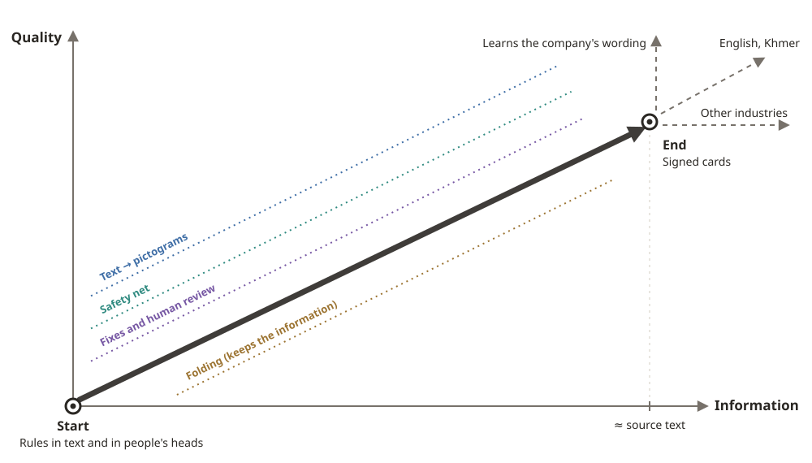

# genba-kamishibai

[](https://github.com/tirotiro0207/genba-kamishibai/actions/workflows/test.yml)

English | [日本語](README.ja.md)

> **Draft.** This README is being written. Numbers marked **TBD** are filled in at the end from the counting script. Anything marked **not built** does not exist yet. Progress: [docs/progress.md](docs/progress.md) · task list: [docs/plan.md](docs/plan.md).

## Try it

- Public demo: **https://genba-kamishibai.ikjshare.workers.dev** — opens on the fictional demo company. No sign-in, no PIN.
  - Look at the signed cards one by one, open the route from a picture back to its source sentence, and make a card from a short rule of your own (the demo has a daily cap).
  - Try it yourself the way the new hires did: "answer against the clock" and "answer from the picture only".
- Company tenants are private. They open with two PINs: the tenant PIN, then the PIN of your role (author, supervisor, trainer or new hire).
  - Inside a company there are two doors: the **maker side** (author, supervisors, trainer) with three tabs, cards / characters / picture parts, and the **reader side** (new hires and anyone on site), which shows signed cards only. A test, when there is one, is reached from the bottom of the reader side.
  - New cards are made in a chat: attach PDF, Word, Excel, plain text or a photo of a paper notice, and say what you want. The reply is a bullet list of rules, all checked; untick what you do not want and press "make these cards".
  - Picture parts: every prop used in the pictures is listed. Write what to change and attach a photo or a sketch; Claude redraws the part, the old and new are shown side by side, and only an author or supervisor can adopt it for the company. Every version is kept.
  - Scoring the on-site answers: `#/t/<tenant>/score`. The author's tab is on the left, the supervisor's on the right. Each gives every answer a score from 1 to 10 and a comment, and cannot see the other's scores (append-only).
- "Try as a guest" on the first screen makes a throwaway space just for you and opens the maker side as the author (no reader side). When making your character, electrical work is the only industry that can be chosen for now; the others are listed but locked. Guests have a daily cap on AI calls.



From rules that lived in text and in people's heads (start), fold the information into pictures without losing any of it (quality, quantity), and deliver it to new hires as signed cards (end). From there, spread to other industries; as more nationalities join, keep reaching them with pictures and plain Japanese (with furigana) rather than translations; and learn each company's wording (beyond the end).

Quality goes up, quantity (information) goes right. Progress per task: [docs/dashboard.html](docs/dashboard.html) · [docs/plan.md](docs/plan.md); the hand-drawn sketch: [docs/sketches/shinro.jpg](docs/sketches/shinro.jpg)

## The Problem

- On a construction site, the safety rules live in written manuals and in the heads of veteran workers.
- New hires from abroad often cannot read those rules in Japanese text.
- The people who train them have no time to make teaching material that actually gets through.
- Accidents happen at the edge where confidence turns into overconfidence. Veterans are readers of the rules too, not only the people who carry them in their heads. A kamishibai card on the site wall stands beside the hazard-prediction sheets and safety notices as one more layer of protection: even when you already know the rule, just having it there in sight every day tightens your attention.

## Why I built this

- The author works with an electrical contractor (founded in 1923) that hires new staff from abroad (at the on-site check on 2026-11-06: Vietnam, Myanmar and Cambodia, next to two Japanese new hires).
- A rule that is misread on site can hurt someone. A picture card that a supervisor has checked and signed is safer than a machine translation nobody checked.
- The card's words are in plain Japanese only. A supervisor signs only what they have read and agreed with, so a translation the supervisor cannot read is not put on the card.
- Direction of the project: [docs/compass.md](docs/compass.md).

## Ideas behind it

From [docs/compass.md](docs/compass.md), the axis the project comes back to when in doubt:

- **Change in quality: natural words become pictures.** Spoken words and manual sentences turn into pictogram cards. "Quality" means one thing: does it get through? It goes up in three ways: drawing it as a picture, a safety net that stops dangerous misreadings, and fixing the card with the voices of supervisors and new hires.
- **Change in quantity: fold, do not cut.** A reader sees less at once, but a card holds what its source said (card ≈ source). The picture is the information folded up; unfold it and every part has a **route** back to the line it came from, so every card can return to its source.
- **No translation.** The card's words are plain Japanese with furigana, written to the national guideline for plain Japanese (three steps: [docs/yasashii-nihongo.md](docs/yasashii-nihongo.md)). A supervisor signs only what they can read, and the same card keeps working as nationalities increase.
- **A person signs; the server enforces it.** Claude drafts and checks. Only a supervisor's signature lets a card reach readers, and the server refuses unsigned, stopped or changed-after-signing cards.
- **Veterans read too.** Accidents come where confidence turns into overconfidence. The same card is read at the morning meeting and posted on the site wall, next to the hazard-prediction sheets and safety notices; even people who know the rule get a little sharper each time it catches their eye.
- **Kamishibai.** Cards are shown one at a time, and the screen moves like a picture pulled from a kamishibai frame.

## What it does

Turns a rule written in Japanese (or spoken by a veteran) into a picture card — pictograms that show *what to do* and *why* — that can be read without Japanese text. Only cards that a supervisor has corrected and signed reach new hires.

The flow (details in [docs/flow.md](docs/flow.md)):

1. **Input** — paste or speak a rule, or attach a PDF of a manual (pages become images and numbered lines).
2. **Extraction** — Claude picks out the rules (what to do, what not to do, why), each tied to its line in the source. A person approves which ones become cards.
3. **Card making** — Claude writes the card's text and the keyframes of the pictogram figures as numbers; the app draws the picture. Every part of the picture keeps a **route** back to the sentence it came from.
4. **Checking** — a second Claude call looks only at the frames, guesses the meaning, and grades the card red / yellow / green. Red cards go to the top of the review queue.
5. **Human fixes** — a supervisor draws a box on the part that is wrong and says what to change; only that card is remade. Joints and props can also be moved by hand.
6. **Signature** — a supervisor signs with a finger or a stamp. There is a daily cap per supervisor, and the server refuses to hand out unsigned cards.
7. **Issue** — signed cards reach new hires one at a time, kamishibai-style. Only a supervisor can stop a card, always with a reason; the trainer then gets a recall notice (who saw the card is listed on the issue screen, and posted copies to take down are listed with it).

Screens (the fictional demo company; provisional — retaken once the pictures are final):

| | |
|---|---|
|  Public demo entrance |  Card: the picture, the "unapproved draft" band and the checking band |
|  Route: a part of the picture → its source line |  Review queue: red cards first |
|  Signature with a stamp |  What a new hire sees: signed cards, one at a time |

Also built:

- Roles: author, two supervisors, trainer, new hire. Company tenants need a tenant PIN and a role PIN.
- Audit log: append-only, hash-chained record of each card (source → making → checking → human edits → signature), with a screen for supervisors and trainers.
- Folding screen: shows the source pages stacking up and folding into one card with no text.
- Answer recording app for the on-site check: timing (card vs. text), free answers, two graders, anonymized CSV export, erasing a participant who withdraws, and the trainer's forecast per card written before any answer comes in.
- Scoring screen (11/7): the author and a supervisor score every answer from 1 to 10 with a comment, and also score each card for "how much gets through from the picture alone". Neither sees the other's scores; records are append-only. Answers in the reader's own language can get a reference Japanese translation by Claude, so the graders can read them (it is deleted with the answer if a participant withdraws).
- Overnight sorting of a whole manual (which pages hold rules a worker must follow), with a supervisor screen to swap the answers.
- Reader panel: 24 simulated readers (country of origin × Japanese reading level × background), each a Claude Code subagent, used to find pictures that do not get through before the real check. For the 30 rules whose answers were fixed (with a hash) before any reading, each reader saw all 30 pictures at once in a different order; two risky cards and one easy card were also read one at a time by the same 24 readers to check the score shift (no card was read the opposite way either way, so the fallback to one-at-a-time reading was not triggered). Results: [docs/readers.md](docs/readers.md).
- MCP server: other tools can ask for cards; it can only make **unapproved drafts**.
- PNG / SVG export with version, signature date and frame number on each picture.
- Navigation: the home screen links to the review queue, issue, trials and making screens and to each card (route, folding, record, signature); every other screen has a "← Home" bar.
- New card types (11/7 defaults, awaiting the author's review; details in [docs/decisions.md](docs/decisions.md)):
  - **Principle cards** (`shape=principle`) are the one exception to 3–4 frames: a single frame, chosen with "make as a one-frame principle". All other cards keep 3–4 frames.
  - **Bundles**: cards made from the same parent rule of one extraction are kept together (bundle name, n of total, the parent rule) and listed in order. Up to 30 cards per bundle.
  - **Weight**: a supervisor marks a card "life-critical" or "normal". Life-critical cards get a red border outside the picture (on the reading screen and on the export/print frame), never inside it.
  - **Poster version**: the frames of one card on one large landscape sheet (with furigana, version and date), and a sheet of principle cards in one row.
  - **Morning-meeting set**: describe the day's work and up to 8 matching signed cards are suggested (life-critical first); the chosen set is kept.
  - **Where it is posted**: signed cards can be recorded with the place they are posted; when a card is stopped, those sheets appear in the recall notice as "take down".
  - **Past accidents** can be added as a source for the "why".

### Inside: where each step runs

The app is one Cloudflare Worker (Hono) with D1 (records) and R2 (files), and a React screen built with Vite. Pictures are drawn by the app's own SVG code, not by an image model: Claude only writes numbers (joint angles, props, positions).

| Step | Where in the code |
|---|---|
| Input (chat with attachments: PDF, Word, text, photos of paper) | `src/client/chat/`, `src/worker/chat.ts` (PDF pages → text with Claude), `src/client/make/` |
| Extraction (rules with their source lines) | `src/shared/extract/`, `src/worker/extract.ts` |
| Card making (text, keyframes, routes; plain-Japanese words with furigana) | `src/shared/make/maker.ts`, `words.ts`, `src/shared/ruby.ts`. The two-step script stage (`script.ts`) is off by default since 11/6 |
| Drawing | `src/shared/picto/` (skeleton → named poses → character with outfit and hair → props → scene). New poses are derived from named ones: at least 7 joints stay fixed and up to 3 move by at most 30° |
| Checking and safety net | `src/shared/verify/` (reads the frames only; a card passes only above the line and with no dangerous reading), the review queue `src/worker/queue.ts` |
| Human fixes | `src/client/fix/`, `src/client/pose/`, `src/shared/rework.ts` (remakes only the boxed parts, so routes stay) |
| Signature | `src/worker/sign.ts`, `src/client/sign/` |
| Delivery | `src/worker/read.ts` (signed and unchanged only, no routes), `src/client/read/`, `src/worker/issue.ts` (stop, recall, who saw it) |
| Audit | `src/shared/audit.ts`, `src/worker/audit.ts` (append-only, hash-chained) |
| Overnight sorting and drafting | `src/node/night*.ts`, `src/node/managed-sort.ts` |
| Other tools | `src/worker/mcp.ts` (MCP: drafts only) |
| On-site check and scoring | `src/worker/trials.ts`, `src/worker/scores.ts`, `src/client/trial/`, `src/client/score/` |
| Guest space | `src/worker/guest.ts` (one throwaway space per guest, daily caps) |
| Picture parts (props, clothes, expressions) | `src/worker/assets.ts`, `src/client/assets/`, `src/shared/picto/asset-rules.ts`, `src/shared/picto/prop-override.ts`, [docs/assets.md](docs/assets.md) (versions are append-only; the SVG Claude returns is filtered to safe elements and turned gray; expressions are a fixed set of parts, not SVG) |
| Taking in shared updates | `scripts/intake-check.ts`, `scripts/git-hooks/post-merge`, `.github/workflows/intake.yml`, [docs/sharing.md](docs/sharing.md) |

### On-site check (2026-11-06)

- 14 new hires from four countries (Japan 2, Myanmar 2, Vietnam 2, Cambodia 8) took two tests on laptops: (1) time to understand two items, one shown as a card and the other as the original manual page; (2) eight cards, with half of each person's cards shown with their plain-Japanese words and half picture only (the two are counted apart; the reference lines are applied to "picture only").
- How to count was fixed before any answer was seen, and its hash is in [docs/numbers.md](docs/numbers.md): [docs/fieldday-2026-11-06.md](docs/fieldday-2026-11-06.md).
- Answers reached the app from 9 people (Japan 2, Myanmar 2, Vietnam 2, Cambodia 3): 18 of 28 for (1) and 48 of 112 for (2). The missing answers and why they were lost: [docs/failures.md](docs/failures.md) (section 4). Missing answers are not guessed into any number.
- Scoring is under way: the author and a supervisor each score every answer from 1 to 10 with a comment, separately. The results go into the Numbers table only after both have scored.
- In the afternoon, two supervisors each approved cards, and the printed cards were used in a morning-meeting setting. A veteran electrician posted them on a mock site and said the pictures make it easy to understand, the plain Japanese has everything needed with nothing left out, and that they want to use them at morning meetings. Two things to fix: bigger frames on the printout, and switchboard-type props that look like the real equipment (after the build period).

Who owns the data: the edit and signature records belong to the company that signed up. The author's company only keeps them, and never uses them to draft cards for another company. Only how a picture was fixed ("this pose was read the wrong way") may go back into the shared drawing rules, with the company's text and all names removed, and only if the company chooses to allow it; the default is "no", and today every company is on "no" (there is no switch for it yet). If you run it yourself, all data stays with you. Details: [docs/consent.md](docs/consent.md).

## How Claude is used

| Where | Model | What it does |
|---|---|---|
| PDF → text | Claude Opus 5.5 | Reads the page image only for pages with no text layer, and writes the text with line positions |
| Extraction | Claude Opus 5.5 | Picks out rules (what to do / not to do / why) with their source positions |
| Card making | Claude Opus 5.5 | Writes the keyframes and a route for every part of the picture, as numbers (it does not draw the picture directly) |
| Checking | Claude Opus 5.5 | Looks only at the frames and grades the card; it never sees the card's text |
| Word field | Claude Opus 5.5 | Writes short plain-Japanese lines from the card's text only (a Vietnamese line is optional: when one is written it is kept internally only and never delivered) |
| Overnight sorting | Claude Managed Agents | Reads a whole manual page by page and says which pages hold rules a worker must follow; resumable |
| Grading the extraction | Claude Sonnet 5.5 | Compares extracted rules with the evaluation answers |
| Reader panel | Claude Code subagents (Sonnet 5.5 by default) | Each simulated reader is one subagent; the model ID is kept with every answer |

- Every API call is logged with its cost, and each use has a spending cap (per call, per day, in total).
- The app itself was built with Claude Code.

### Running the whole program before spending on the API

Before the overnight run on the API, the same program was run end to end with only the calls to Claude swapped for `claude -p` (the Claude Code CLI on a subscription). Everything else stayed the same: the database writes, the resume logic, the checks. This finds bugs in the program itself (answers it cannot parse, resumes that drift, pages left out), not only in the prompts. Having Claude do the work by hand inside a chat would skip the program, so those bugs would stay hidden.

- Run: 109 pages sorted, 123 draft cards from 62 pages, 4 runs at once, stopped on purpose and resumed. Drift after the resume: 0.
- Problems found: 8. Fixed before the API run: 3 (parallel writes to the local database, a Vietnamese decimal comma read as a new number, no tool to count resume drift). The other 5 are written down with the reason they remain.
- Details: [docs/dry-run-063.md](docs/dry-run-063.md).

### What the supervisors' review showed about the AI

The extraction was tested on 30 items cut from Japanese laws and public materials (the evaluation data under Before / During), and two supervisors marked every answer. What the AI gets wrong, as found:

- Exceptions and supplements are often far from the sentence: later in the same paragraph, in another article, in an enforcement regulation or a ministry notice. The AI summarizes only the text in front of it, so it misses them. Cue words ("however", "except") catch some cases, not all.
- The "why" is usually not written in the source. The AI left it out; the supervisors added who and what the rule protects.
- Plain rewording can change the meaning (for example, "six months of continuous work" read as "never taking a day off").
- Tuning on 20 items raised their score from 0.81 to 0.96, but the 10 held-out items only moved from 0.79 to 0.80. The gain did not carry over.
- The final run on all 30 items, against the answers after the supervisors' review (the 10 held-out items were checked against their stored hashes first): Opus 5.5, the model the product uses, matched 58 of the 86 answer points (21 more of them only in wording), missed 28, added 6 that are not in the answers, and made **0 dangerous misreadings** (0.69 USD). Fable 5.1 matched 61, missed 25, added 7, also 0 dangerous (1.81 USD, about 2.6 times the cost). Numbers: [docs/numbers.md](docs/numbers.md), script `scripts/eval30.ts`.
- Examples taken from the test material make scores look better without showing real ability, so prompt examples come from outside it, and every prompt is checked for overlap with it.

Because of this, a supervisor's check is a step the system depends on, not an extra. Details: [docs/lessons-extraction.md](docs/lessons-extraction.md).

## Quick Start

Requires Node.js 24.

```bash
npm ci
```

```bash
npm test
```

Tests marked 【手元限定】 (local only) need files under `private/` or the manual PDF and skip when they are missing (they always skip on CI).

To run the app locally, put `SESSION_SECRET` (any long random string) and `ANTHROPIC_API_KEY` in `.dev.vars`. `SESSION_SECRET` is required: without it, signing in with a role fails. Without the API key the app still starts and every screen opens, but calls to Claude (extraction, card making, checking) return 503. To start with only `SESSION_SECRET`:

```bash
node -e "require('fs').writeFileSync('.dev.vars', 'SESSION_SECRET=' + require('crypto').randomBytes(32).toString('hex') + '\n')"
```

Node writes the file itself, so this works the same in bash and in Windows PowerShell (with `> .dev.vars`, Windows PowerShell 5 writes UTF-16, which wrangler cannot read, and `SESSION_SECRET` looks missing). It overwrites `.dev.vars`.

 The names shown for each role (`SUPERVISOR_1_NAME`, `SUPERVISOR_2_NAME`, `TRAINER_NAME`, `AUTHOR_NAME`) also go in `.dev.vars`; if they are missing, the name is left blank. The local Node scripts in `scripts/` read `.env` instead (see `.env.example`).

```bash
npx wrangler d1 migrations apply DB --local
```

The fictional demo company's ten signed cards come as seed data (`demo/seed.sql`, fictional company only). Load them once, after the migrations, so its screens (`/` and "try it yourself") and their recorded tests (`demo`, `try`) work without an API key:

```bash
npx wrangler d1 execute DB --local --file demo/seed.sql
```

To make the demo cards again from scratch instead, the full pipeline calls Claude, so it needs `ANTHROPIC_API_KEY` (with `npm run dev` running): `BASE_URL=http://localhost:8787 npx tsx scripts/demo-cards.ts`, then `npx tsx scripts/demo-seed.ts` writes the seed file again.

```bash
npm run dev
```

Then open http://localhost:8787/#/t/practice/make (the practice tenant: no PIN). If port 8787 is taken, use `npm run dev -- --port 8799`.

Recorded browser tests (run one at a time; the local database does not take parallel writers). The first time, install the browser:

```bash
npx playwright install chromium
```


```bash
npx playwright test --workers=1
```

### Use it from other tools (MCP)

The Worker is also an MCP server (Streamable HTTP) at `/mcp/<tenant>`. Ask "turn this document into cards" and the same pipeline runs: extraction → approval of the chosen rules → card making. There is no tool for signing, approving or stopping, and calls that try are refused. A supervisor signs on the screen.

- Each company tenant needs its own key, sent as `Authorization: Bearer <key>`. Only the fictional demo company works without a key — in the local environment. On the public deployment the practice and fictional tenants also need a key and are read-only (`list_documents` and `get_card`; extracting and making are refused, and `initialize` says so). The `/mcp/demo` example below is for the local environment.
- Make a key for a local tenant (the key is written only to `private/tenants/<tenant>-mcp.json`; the database keeps its hash):

```bash
npx tsx scripts/add-mcp-key.ts practice
```

```bash
claude mcp add --transport http genba http://localhost:8787/mcp/demo
```

- Tools: `list_documents`, `doc_to_cards`, `extract_rules`, `make_drafts`, `get_card`.

## Before / During

What existed before the build period (2026-11-02) and what was made during it.

**Before**

- Evaluation data (`eval/`): 30 source sentences chosen by the author from Japanese occupational-safety law and public materials of the Ministry of Health, Labour and Welfare; the source is on each line. The answers were drafted by the author with AI assistance and are being reviewed by two site supervisors. 20 items are used for tuning; 10 are kept apart for the final check (only their hashes are in the repository). None of the 30 answers is in any prompt or example.
- Hand-drawn sketches (`docs/sketches/`), drawn by the author. The pictogram parts were adjusted to match them.
- The pilot company's safety manual. It is the company's document, so it is not in this repository; cards made from it live only in that company's private tenant.

**During**

- All code was written from scratch. No code or HTML made before the build period was brought in.
- All production prompts were written from scratch.
- The Vietnamese in each card's word field was translated by Claude and collected in a small glossary (Japanese · Vietnamese · which card uses it). The Vietnamese line is optional: when it is written it is kept internally only and is not delivered (cards are in plain Japanese only).

## Disclosure

The author provides a separate paid translation service to the company where this was piloted (an electrical contractor founded in 1923). So that the results cannot be tilted in the author's favor, every new hire's answer is recorded by the app itself (append-only — no edits, no deletions), and the answers of those who agree to publication are published anonymously in `docs/answers.csv`.

This product deliberately has no translation feature, so that nothing a supervisor cannot read and check reaches the new hires. (The optional Vietnamese line of the word field, when it is written, stays internal and is never delivered.)

The author intends to offer this as a hosted service in the future (MCP access uses a separate key for each company).

## Who it is for

TBD — one paragraph: who pays (companies that hire workers from abroad, starting with electrical work), what they pay for (turning their own manuals into signed picture cards, with an audit trail), and what stays free.

## Numbers

| | |
|---|---|
| First commit | 2026-11-02 13:21 (JST) |
| Commits | TBD |
| Tests | TBD |
| Pictures understood by new hires (picture only) | TBD |
| Dangerous misreadings | TBD |
| Time to understand: card vs. text | TBD |

How "time to understand" is measured: the timer starts when the cover has fully lifted and stops at "Got it". The card is shown fitted to one screen (it is a picture, so it stays readable). The original manual page is shown at full width with scrolling, so its text stays readable without zooming; scrolling time counts as reading time, the same way people page through the manual today. On both sides "Got it" stays pinned to the bottom of the screen.

Measured numbers and their sources: [docs/numbers.md](docs/numbers.md).

## Not built

- Results of the on-site check with new hires — **not built** (scoring by two graders is under way)
- Picture parts: only props can be redrawn for now (not poses, hair or clothes), and the redrawn part is used in pictures drawn in the browser, not yet in exports or video stills — **not built**
- The paid part of the intake check (re-running the 20 tuning items) runs only when asked with `--run-paid`; CI never calls the API and stops with "evaluation needed" instead — by design, not a gap
- The 2-minute and 3-minute videos — **not built**
- A screen to list, edit and delete a company's own words (they are saved and mixed into the examples for the next card, but there is no screen) — **not built**
- Skills for electrical work and labor conditions (`skills/`): drafts only, not connected to any call yet — **not built**

## Appendix

- How it works, step by step: [docs/flow.md](docs/flow.md)
- Decisions and why: [docs/decisions.md](docs/decisions.md)
- Reader panel: [docs/readers.md](docs/readers.md)
- Measured numbers: [docs/numbers.md](docs/numbers.md)
- Build log: [docs/build-log.md](docs/build-log.md)
- Screen check list: [docs/audit.md](docs/audit.md)
- API notes (endpoints the screens do not call, and the 11/7 additions): [docs/api.md](docs/api.md)
- Running it: production steps, overnight batch, CI, copy tools: [docs/operations.md](docs/operations.md)
- How the yellow rows will be measured: [docs/numbers.md](docs/numbers.md)

## License

- Code: **GNU Affero General Public License v3.0 (AGPL-3.0)**. Full text: [LICENSE](LICENSE).
- Documents in `docs/`, and pictures exported from the pictogram parts list (PNG / SVG): **Creative Commons Attribution 4.0 (CC BY 4.0)** — https://creativecommons.org/licenses/by/4.0/
- The name "genba-kamishibai" and its logo are not covered by either license.
- The Claude character in the demo video is drawn as an unofficial fan work. / Claude のキャラクターは、非公式のファン作品として描いています。

Why: this is a tool that touches safety on site. If someone improves it and runs it as a service, AGPL makes those improvements public too, so they come back to everyone. The parts and the documents are CC BY so that people in other industries can reuse them freely.
