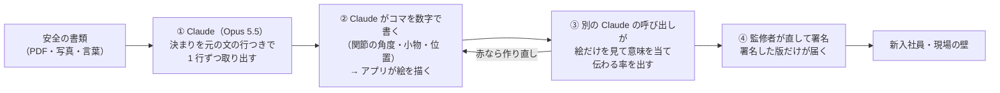
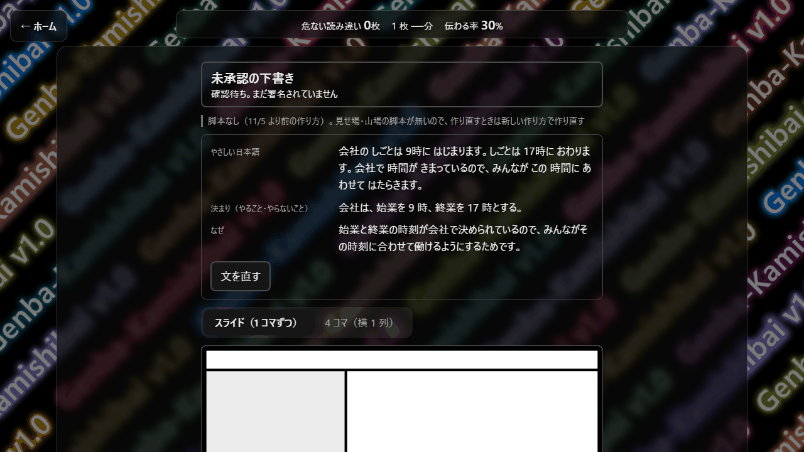
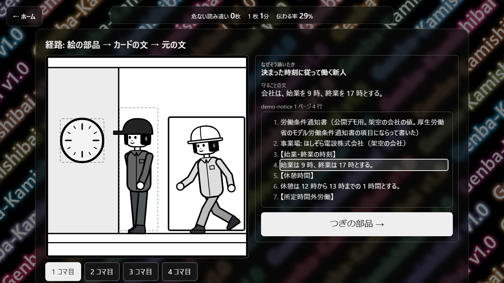
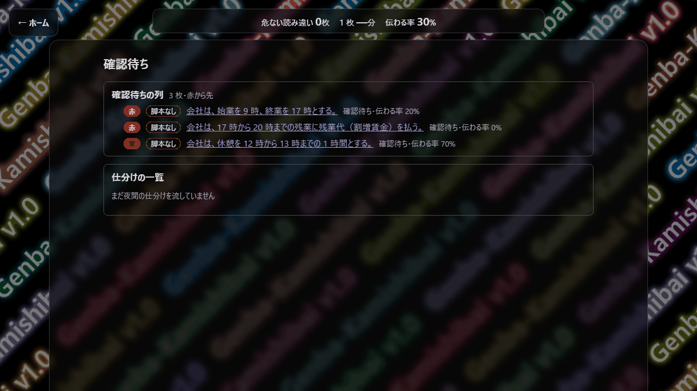
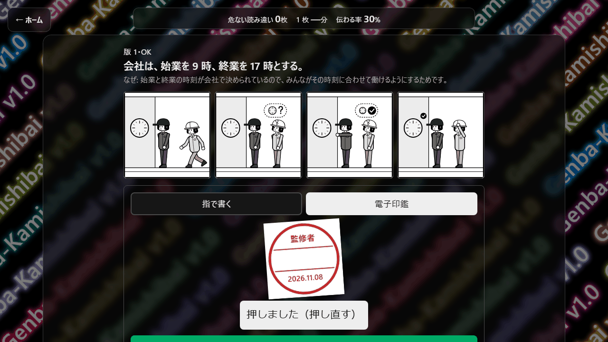
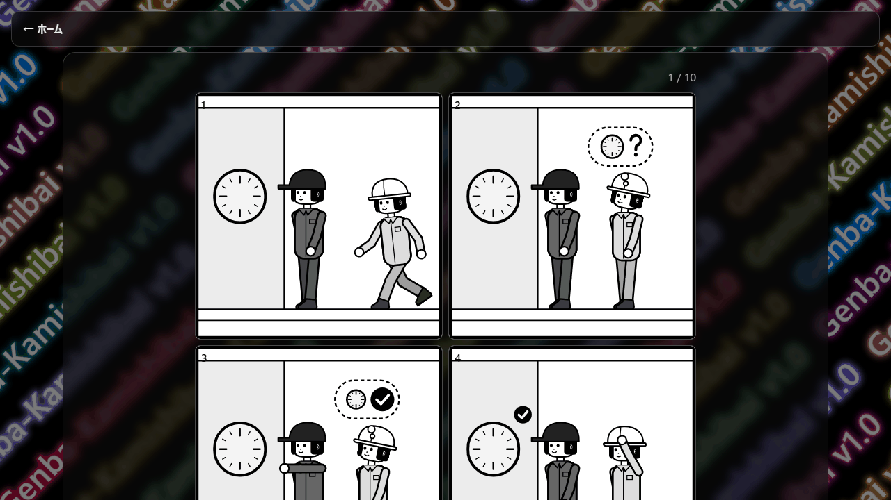

# 現場の紙芝居 (genba-kamishibai)

会社の安全の書類を、外国籍の新入社員にも伝わる「絵とやさしい日本語（ふりがなつき）のカード」にするアプリです。Claude が下書きし、監修者が直して署名したカードだけが現場に届きます。

[English below](#english)

> **コードは非公開です。導入・協業のご相談は、下の連絡先へ。**

- 動画（3 分）: https://youtu.be/Gd8hjogxsgA
- デモ・操作の動画（16 分・待ち時間だけ省略）: https://youtu.be/9WRtGGyaGUM
- 公開デモ（ログイン不要。監修者が署名したカードの写し 2 枚と、絵の部品）: https://genba-kamishibai.ikjshare.workers.dev/#/t/demo
- 作る側を試す（ゲストの部屋）: https://genba-kamishibai.ikjshare.workers.dev を開き、「ゲストで動作確認する」を押す。あなただけの使い捨ての置き場で、ログイン不要。AI を呼ぶ操作は 1 日 5 回まで。**2026-11-20 23:59（日本時間）まで**

## 前 → 後

| | 前 | 後（このアプリ） |
|---|---|---|
| 教材にする手間 | 協力いただいた電気工事会社の安全の書類は **109 ページ**。教材にするには **約 359 時間**（1 ページ約 3 時間・同社の試算） | （教材にする手前の）仕分けだけ: 109 ページを、カードにする決まりがあるページとないページに Claude が仕分けて **14 分・0.93 USD**（本番で 1 回流した実測）。教材にするまで全体の時間は、まだ測っていない |
| 絵のカード | 外注すると **8 枚で約 1 か月・約 5 万〜22 万円**（相場からの推定） | 下書きは **8 枚で 50 秒・API 約 118 円、1 枚 約 15 円**（2026-11-02 の実測。仮の流れ・作り直し込み） |
| 届くまで | — | 人が確かめて署名する時間は、上とは別にかかります |

数の出どころと断り書き: [NUMBERS.md](NUMBERS.md)。前の側の数は作者の提供（同社の試算と相場からの推定）で、測ったものではありません。1 USD ≒ 157 円で換算。

## Claude の使い分け

| | だれが | すること |
|---|---|---|
| ① | Claude（Opus 5.5） | 書類から、守る決まり（やること・やらないこと・なぜ）を、元の文の行に結び付けて 1 行ずつ取り出す |
| ② | Claude ＋ アプリ | Claude はコマを数字（関節の角度・小物・位置）で書くだけ。絵はアプリ自前の SVG のコードが描く（画像の生成 AI は使わない） |
| ③ | 別の Claude の呼び出し | カードの文を見せずに絵だけを見せて意味を当てさせ、**伝わる率**を出す。伝わる率 = 当てた意味を決まりの文ごとに照らした点（守ること 6 割・なぜ 4 割。合う 1・一部 0.5・合わない 0）。80 以上が緑、60〜79 が黄、60 未満は赤で作り直し |
| ④ | 監修者（人） | 違う部品を枠で囲んで直し、署名する。署名した版だけをサーバーが新入社員に渡す。署名のあとに変わったカードは渡さない |

- コードは 2026-11-02〜11-08 に Claude Code で書いた
- 本番の確認の前に、仮の読み手 24 人（1 人 1 つの Claude Code のサブエージェント）に絵だけを読ませ、伝わらない絵を見つけた
- ほかの道具から MCP でつなげるが、作れるのは**未承認の下書き**だけ

## 画面（架空の会社のデモ）

| | |
|---|---|
|  カード: やさしい日本語・決まり・なぜ |  経路: 絵の部品を押すと、元の文の行が光る |
|  確認待ち: 確かめる AI が赤にしたカードが先頭 |  署名: 監修者が電子印鑑を押す |
|  新入社員に届く画面: 署名済みのカードを 1 枚ずつ | |

## 現場での試し（2026-11-06）

- 協力いただいた電気工事会社で、新入社員 14 人（日本 2・ミャンマー 2・ベトナム 2・カンボジア 8）がノートパソコンで試した。アプリに答えが届いたのは 9 人分で、① 分かるまでの時間は 28 件中 18 件、② 8 枚のカードは 112 件中 48 件。届かなかった分を推し量って数に入れることはしない
- 数え方は答えを見る前に固めた。結果は作者と監修者の 2 人が別々に採点中で、2 人とも付け終わるまで数は出さない
- 同じ日、監修者 2 人がカードを承認・署名し、ベテランの電気工事士が印刷して現場を模して貼って使った（声:「絵があって分かりやすい」「抜け漏れが無い」「朝礼で使いたい」）

## これから

- カードを貼る前と後で、現場の事故の件数を半年〜1 年かけて比べる（現場からの提案）

## 協力・連絡先

- 協力: 東光電気工事株式会社（https://www.tokodenko.co.jp/）（現場での試用・安全の書類・監修）
- 導入・協業のご相談: ichiromiki1997@gmail.com
- X: https://x.com/tirotiro_dev

---

# genba-kamishibai (English)

genba-kamishibai turns a company's safety documents into cards that new hires from abroad can follow: pictures plus plain Japanese with furigana. Claude drafts each card; only cards a supervisor has corrected and signed reach the site.

> **The code is private. For adoption or partnership, please use the contact below.**

- Video (3 min): https://youtu.be/Gd8hjogxsgA
- Demo / walkthrough video (16 min, only idle waits cut): https://youtu.be/9WRtGGyaGUM
- Public demo (no sign-in; copies of 2 cards signed by supervisors, and the picture parts): https://genba-kamishibai.ikjshare.workers.dev/#/t/demo
- Try the authoring side (guest space): open https://genba-kamishibai.ikjshare.workers.dev and press "ゲストで動作確認する" (Try as a guest). A throwaway space just for you, no sign-in, up to 5 AI operations a day. **Open until 2026-11-20 23:59 Japan time** (the screens are in Japanese)

## Before → After

| | Before | After (this app) |
|---|---|---|
| Turning documents into teaching material | The participating electrical contractor's safety documents run to **109 pages**. Making them into teaching material takes **about 359 hours** (about 3 hours a page; the company's own estimate) | Only the sorting step (before making any teaching material): Claude sorts the 109 pages into pages with rules to turn into cards and pages without in **14 minutes, 0.93 USD** (measured, one run in production). The total time until the material is finished has not been measured yet |
| Picture cards | Outsourced: **8 cards take about a month and about 50,000-220,000 yen** (estimated from market rates) | Drafts: **8 cards in 50 seconds, about 118 yen of API cost, about 15 yen a card** (measured on 2026-11-02; provisional pipeline, including redrafts) |
| Until delivery | — | The time a person spends checking and signing comes on top of this |

Sources and caveats: [NUMBERS.md](NUMBERS.md). The "before" figures were provided by the author (the company's estimate and a market-rate estimate) and were not measured. Converted at about 157 yen to the dollar.

## How Claude is split across the work

| | Who | What |
|---|---|---|
| 1 | Claude (Opus 5.5) | Extracts each rule (do, don't, why) one by one, tied to the line in the source document |
| 2 | Claude + the app | Claude only writes the frames as numbers (joint angles, props, positions). The app's own SVG code draws the picture (no image-generation model) |
| 3 | A separate Claude call | Shown only the picture, never the card's text, it guesses the meaning; the **get-through rate** is that guess scored against each sentence of the rule (what to do 60%, why 40%; match 1, partial 0.5, no match 0). 80+ is green, 60-79 yellow, under 60 red and redrafted |
| 4 | A supervisor (a person) | Boxes the wrong part, corrects it and signs. The server hands new hires only the signed version, and nothing that changed after signing |

- The code was written from 2026-11-02 to 11-08 with Claude Code.
- Before the on-site check, 24 simulated readers (one Claude Code subagent each) read the pictures alone to find the ones that did not get through.
- Other tools can connect over MCP, but can only create **unapproved drafts**.

## On-site trial (2026-11-06)

- At the participating electrical contractor, 14 new hires (Japan 2, Myanmar 2, Vietnam 2, Cambodia 8) tried it on laptops. Answers from 9 of them reached the app: (1) time to understand, 18 of 28; (2) eight cards, 48 of 112. Missing answers are not estimated into the numbers.
- The counting rules were fixed before seeing the answers. The author and a supervisor are scoring separately, and no numbers are published until both finish.
- The same day, two supervisors approved and signed cards, and a veteran electrician printed them and put them up as on site ("the pictures make it easy to understand", "nothing is missing", "I want to use it at the morning meeting").

## What's next

- Compare the number of accidents on site before and after the cards go up, over six months to a year (proposed by the site).

## Thanks and contact

- Partner: Toko Electrical Construction Co., Ltd. (https://www.tokodenko.co.jp/) — on-site trial, safety documents, supervision
- For adoption or partnership: ichiromiki1997@gmail.com
- X: https://x.com/tirotiro_dev
